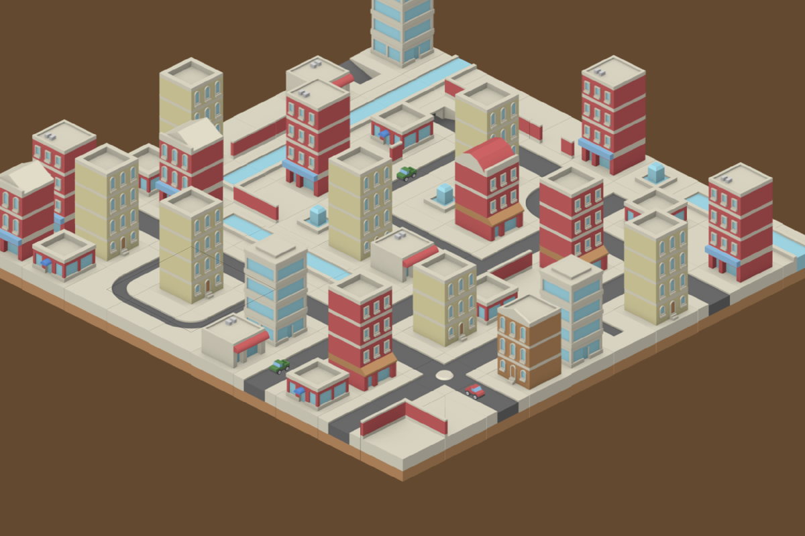

# Demo App

How the demo app in `Demo/` is built: its project settings, its architecture and what each file does. It is also a working reference for using SKTiled from SwiftUI; [Creating a SwiftUI App](swiftui-app.md) builds a minimal app from scratch.

The app has two tabs, in order of complexity:

1. **Maps** loads and renders Tiled maps: the library's basics.
2. **Lode Runner** plays level 1 of the 1983 game on a map loaded with SKTiled: sprites, destructible tiles, map objects, collisions, sound and pixel scaling. See [Lode Runner Example](#lode-runner-example).

- [Overview](#overview)
- [Running the Demo](#running-the-demo)
    - [From Xcode](#from-xcode)
    - [From the Command Line](#from-the-command-line)
- [Using the Demo](#using-the-demo)
    - [Choosing a Map](#choosing-a-map)
    - [Toolbar](#toolbar)
    - [Inspector](#inspector)
    - [Navigating the Map](#navigating-the-map)
- [Project Structure](#project-structure)
    - [Files](#files)
    - [Xcode Project Settings](#xcode-project-settings)
- [Architecture](#architecture)
- [Code Walkthrough](#code-walkthrough)
    - [SKTiledDemoApp.swift](#sktileddemoappswift)
    - [DemoScene.swift](#demosceneswift)
    - [DemoModel.swift](#demomodelswift)
    - [MapBrowserView.swift](#mapbrowserviewswift)
- [What Happens When a Map Is Selected](#what-happens-when-a-map-is-selected)
- [SKTiled Features Used by the Demo](#sktiled-features-used-by-the-demo)
- [Snapshot Mode](#snapshot-mode)
- [Extending the Demo](#extending-the-demo)
- [Known Limitations](#known-limitations)
- [Lode Runner Example](#lode-runner-example)
    - [Installing the Assets](#installing-the-assets)
    - [Playing](#playing)
    - [How the Game Uses SKTiled](#how-the-game-uses-sktiled)
    - [Game Code Walkthrough](#game-code-walkthrough)
    - [Verifying Without a Keyboard](#verifying-without-a-keyboard)


## Overview

The demo is a single SwiftUI app for macOS, iOS (iPhone and iPad) and tvOS that loads Tiled maps with **SKTiled** and displays them in a SpriteKit [`SpriteView`][spriteview-url]. It exists for two purposes:

- to show a minimal, idiomatic way of using SKTiled from SwiftUI;
- to let you check your own Tiled content, since any folder on disk can be opened and its maps loaded exactly as Tiled saved them.

The whole app is four Swift files (about 500 lines). All tile map loading, rendering, animation and camera behaviour comes from the SKTiled library; the demo only wires the library to a SwiftUI interface.


## Running the Demo

### From Xcode

1. Open **Demo/SKTiledDemo.xcodeproj**. Xcode resolves the SKTiled package from the repository root (the project references it as a local package, so edits to the library are picked up immediately).
2. Select the **SKTiledDemo** scheme and a run destination: **My Mac**, an iOS simulator or device, or a tvOS simulator or device.
3. Run (**⌘R**).

The project signs with "Sign to Run Locally", so macOS and simulator builds need no configuration. To run on an iPhone, iPad or Apple TV, select your development team in the target's **Signing & Capabilities** tab.

Requirements are the same as for the library: Xcode 26 or later, macOS 14, iOS 17 or tvOS 17.

### From the Command Line

`scripts/check.sh` builds the demo for every platform as part of its checks. To build and launch only the macOS app:

```bash
xcodebuild build -project Demo/SKTiledDemo.xcodeproj -scheme SKTiledDemo \
    -destination 'platform=macOS' \
    SYMROOT="$PWD/.build/check/products" OBJROOT="$PWD/.build/check/intermediates"
open .build/check/products/Debug/SKTiledDemo.app
```

Setting `SYMROOT` and `OBJROOT` keeps the build output in `.build/` even when Xcode's build location preference is set to a custom folder.


## Using the Demo



### Choosing a Map

The sidebar has two sections:

| Section         | Contents                                                                                               |
|:----------------|:-------------------------------------------------------------------------------------------------------|
| **Demo Maps**   | Every `.tmx` file in the app bundle's `Maps` folder (the repository's **Demo/Maps** folder), sorted by name. |
| *Folder name*   | Appears after **Open Folder…**: every `.tmx` file anywhere inside the chosen folder.                   |

Selecting a map loads it and replaces the previous one. The first bundled map is loaded at launch.

**Open Folder…** (sidebar toolbar button, or **File ▸ Open Folder…** / **⌘O** on macOS) opens a folder picker. Choose a Tiled project folder; its maps load with their tilesets, templates and images wherever they sit in that folder, because SKTiled resolves each `source` relative to the file that contains it. If the folder contains no maps, a message says so. Opening another folder replaces the folder section.

The bundled maps cover each map orientation and several tileset styles:

| Map                 | Shows                                                                   |
|:--------------------|:------------------------------------------------------------------------|
| `dungeon-16x16`     | Orthogonal map, several tilesets, many layers, animated tiles.          |
| `hex-65x65`         | Hexagonal map.                                                          |
| `isometric-130x66`  | Isometric map.                                                          |
| `roguelike-16x16`   | Large orthogonal map with animated tiles.                               |
| `sk1-32x32`, `sk2-32x32` | Image-collection tilesets (one image per tile) in a subfolder, placed as tile objects. |
| `staggered-64x33`   | Staggered isometric map with animated tiles.                            |

Asset credits are listed in **Demo/Maps/CREDITS**.

### Toolbar

| Control      | Effect                                                                                  |
|:-------------|:----------------------------------------------------------------------------------------|
| **Grid**     | Draws the tile grid (`DebugDrawOptions.drawGrid`).                                      |
| **Bounds**   | Draws the map's bounding shape (`DebugDrawOptions.drawBounds`).                         |
| **Objects**  | Shows object-layer shapes (`SKTilemap.showObjects`).                                    |
| **Pause**    | Pauses the map (`SKTilemap.isPaused`): tile animations stop and the map is dimmed.      |
| **Zoom Out** / **Zoom In** | Scales the camera zoom by 0.8 or 1.25 over 0.15 seconds.                  |
| **Fit**      | Centers the map and zooms so it fills most of the view (`SKTiledSceneCamera.fitToView`). |

The toggles are remembered while the app runs: switching maps applies the current settings to the new map.

### Inspector

A panel in the lower-left corner of the map shows:

| Row           | Source                                                                   |
|:--------------|:-------------------------------------------------------------------------|
| Orientation   | `SKTilemap.orientation` (orthogonal, isometric, hexagonal or staggered). |
| Size          | `SKTilemap.size`, in tiles.                                              |
| Tile size     | `SKTilemap.tileSize`, in pixels.                                         |
| Contents      | Layer, tileset, tile and object counts.                                  |
| Load time     | `SKTilemap.mapRenderTime`: parsing plus rendering, in milliseconds.      |
| Pointer       | The tile coordinate under the pointer and how many tiles are stacked there (all tile layers). Shown only while the pointer is over the map. |

If a map fails to load, the inspector is replaced by an overlay showing the error's description, for example `image "tiles.png" (referenced by "terrain.tsx") was not found.` Nothing crashes; select another map to continue.

SpriteKit's own statistics (frame rate, node count, draw count) are shown in the view's lower-right corner.

### Navigating the Map

Camera control comes from `SKTiledSceneCamera`, not from the demo:

| Platform | Pan                        | Zoom                                   |
|:---------|:---------------------------|:---------------------------------------|
| macOS    | Drag with the mouse        | Scroll wheel or trackpad scroll; toolbar |
| iOS      | Drag with one finger       | Pinch; toolbar                         |
| tvOS     | —                          | Toolbar                                |

The pointer row of the inspector works wherever SwiftUI reports pointer hover: on macOS, and on iPad with a trackpad or mouse.


## Project Structure

### Files

```
Demo/
├── SKTiledDemo.xcodeproj/        Xcode project (one app target, one shared scheme)
├── SKTiledDemo/                  app sources (a synchronized folder: files added here join the target)
│   ├── SKTiledDemoApp.swift      app entry point, window and menu command
│   ├── ContentView.swift         the two tabs: Maps and Lode Runner
│   ├── DemoScene.swift           SKTiledScene subclass: enables the camera's touch gestures
│   ├── DemoModel.swift           state and behaviour: maps, loading, camera, pointer, debug drawing
│   ├── MapBrowserView.swift      Maps tab: sidebar, map view, toolbar, inspector
│   ├── LodeRunner/               Lode Runner tab: rules, scene and view
│   └── Assets.xcassets           app icons (including tvOS brand assets)
└── Maps/                         Tiled maps, tilesets and images copied into the app bundle
    ├── *.tmx, *.tsx, *.png
    ├── sticker-knight/           maps whose tilesets are image collections
    ├── User/                     your own maps (ignored by git)
    └── CREDITS
└── LodeRunner/                   Lode Runner assets, imported locally (ignored by git except README.md)
```

### Xcode Project Settings

The project is deliberately small; everything notable is listed here.

| Setting                         | Value and reason                                                                                  |
|:--------------------------------|:--------------------------------------------------------------------------------------------------|
| Source folder                   | `SKTiledDemo/` is a *file-system synchronized group*: no file list to maintain in the project.    |
| `Maps`                          | Added as a **folder reference**, so it is copied into the bundle with its subfolders intact. This is the recommended way to ship Tiled content (see [Creating a SwiftUI App](swiftui-app.md#4-add-your-tiled-files)). |
| Package dependency              | Local package reference to `..` (the repository root), product `SKTiled`.                         |
| `SUPPORTED_PLATFORMS`           | `iphoneos iphonesimulator macosx appletvos appletvsimulator` with `SDKROOT = auto`: one target builds for all three platforms. |
| Deployment targets              | iOS 17, macOS 14, tvOS 17.                                                                        |
| `SWIFT_VERSION`                 | 6.0, with `SWIFT_DEFAULT_ACTOR_ISOLATION = MainActor` and approachable concurrency: app code runs on the main actor, like SpriteKit and SKTiled. |
| Info.plist                      | Generated (`GENERATE_INFOPLIST_FILE`), with a generated launch screen and scene manifest on iOS.  |
| App icon                        | `AppIcon` on iOS and macOS; `App Icon & Top Shelf Image` on tvOS.                                 |
| Signing                         | Automatic, "Sign to Run Locally" (`CODE_SIGN_IDENTITY = -`).                                      |


## Architecture

```
SKTiledDemoApp  (@main App)
 └── owns DemoModel  (@State, @Observable)
      ├── scene: DemoScene (SKTiledScene) ───┐
      │     ├── worldNode                    │ displayed by
      │     │    └── tilemap: SKTilemap      │
      │     └── cameraNode: SKTiledSceneCamera
      ├── bundledMaps / folderMaps: [MapEntry]
      ├── selection  ── didSet ──► loadSelection()
      ├── info, errorMessage, hoveredCoordinate
      └── showGrid, showBounds, showObjects, isPaused

ContentView(model)                TabView
 ├── MapBrowserView(model)        Maps tab
 │    ├── MapList      sidebar: List(selection: $model.selection)
 │    └── MapDetail    SpriteView(scene: model.scene) + toolbar + MapInspector overlay
 └── LodeRunnerView               Lode Runner tab (see Lode Runner Example)
```

The Maps tab's design has three rules:

1. **One scene for the app's lifetime.** `DemoModel` creates a single `DemoScene` (an `SKTiledScene` subclass); loading a map replaces the map *inside* that scene (`SKTiledScene.setup(url:)`) instead of creating a new scene. The `SpriteView` therefore never swaps scenes, and the camera keeps working across map changes.
2. **The model owns all behaviour; the views only read and bind.** Views read observable properties (`info`, `errorMessage`, the map lists) and bind toggles and the selection to model properties. Property observers (`didSet`) on the model apply each change to the scene.
3. **SKTiled does the work.** Parsing, path resolution, rendering, tile animation, debug drawing and camera input are library features. The demo adds only what a real app would: choosing files, presenting errors and reflecting state in the UI.

Everything runs on the main actor: SwiftUI views, the `@Observable` model, the SpriteKit scene and SKTiled. No locks or dispatch queues are involved.


## Code Walkthrough

### SKTiledDemoApp.swift

```swift
@main
struct SKTiledDemoApp: App {
    @State private var model = DemoModel()
    ...
}
```

- `@State` keeps one `DemoModel` for the app's lifetime and hands it to `ContentView`.
- On macOS the window opens at 1200 × 800 points (`defaultSize`), and a **File ▸ Open Folder…** menu command (**⌘O**) is added after the standard *New* items. It sets `model.isImportingFolder`, which presents the same folder picker as the sidebar button.

### DemoScene.swift

```swift
final class DemoScene: SKTiledScene {
    override func didMove(to view: SKView) {
        super.didMove(to: view)
        cameraNode.allowGestures = true
    }
}
```

`SKTiledScene` creates its camera in `didMove(to:)`, when the scene is first shown. On iOS the camera attaches pan, pinch and double-tap recognizers to the view but leaves them disabled; this override enables them. On other platforms the property has no effect. The subclass is also the place to add scene behaviour: override `SKTiledScene`'s delegate methods (see [Extending the Demo](#extending-the-demo)).

### DemoModel.swift

#### Types

| Type        | Purpose                                                                                                   |
|:------------|:----------------------------------------------------------------------------------------------------------|
| `MapEntry`  | One map in the sidebar: its TMX `url`, the `bundle` used for fallback lookups (`.main` for bundled maps, `nil` for maps opened from disk), and a `name` derived from the file name. Its `id` is the URL. |
| `MapInfo`   | A snapshot of the loaded map's facts for the inspector, captured once after loading.                     |
| `DemoModel` | The app's state. `@Observable`, so SwiftUI updates only the views that read a changed property.          |

#### State

| Property                        | Role                                                                                     |
|:--------------------------------|:-----------------------------------------------------------------------------------------|
| `scene`                         | The `DemoScene` shown by the `SpriteView`. Its `scaleMode` is `.resizeFill`, so the scene size always matches the view and the camera handles zoom. |
| `bundledMaps`, `folderMaps`, `folderName` | The sidebar contents.                                                          |
| `selection`                     | The selected map's id. Its `didSet` calls `loadSelection()` when the value changes.       |
| `info`, `errorMessage`          | Result of the last load: facts on success, the error's description on failure.           |
| `hoveredCoordinate`, `hoveredTileCount` | The tile under the pointer, or `nil`.                                           |
| `isImportingFolder`             | Presents the folder picker.                                                              |
| `showGrid`, `showBounds`, `showObjects`, `isPaused` | Toolbar toggles. Each `didSet` applies the setting to the current map. |
| `accessedFolder` (private)      | The folder whose security-scoped access is currently held.                               |

#### Launch

`init()` lists the maps in `Bundle.main.resourceURL/Maps`, selects the first and calls `loadSelection()` directly. (Property observers do not run during `init`, so assigning `selection` alone would not load anything.) The scene is not visible yet at this point; that is fine, because `SKTiledScene` can set up a map before it is presented and configures its camera when it is.

#### Finding Maps

`findMaps(in:bundle:)` walks a directory recursively with `FileManager.enumerator(at:)`, keeps files with a `.tmx` extension (any case), and sorts them with `localizedStandardCompare` so that names containing numbers sort naturally.

`openFolder(_:)` is called with the folder chosen in the picker:

1. It releases access to the previously opened folder and calls `startAccessingSecurityScopedResource()` on the new one. On iOS the picker grants access to the folder only through that call; without it, the tilesets and images next to the map could not be read. On macOS the call is harmless.
2. It lists the folder's maps (with `bundle: nil`, since files on disk have no bundle to fall back to) and selects the first, which loads it. If there are none, it sets `errorMessage`.

#### Loading a Map

`loadSelection()` finds the selected `MapEntry` and calls:

```swift
let tilemap = try scene.setup(url: entry.url, bundle: entry.bundle, loggingLevel: .warning)
```

On success it clears `errorMessage`, captures a `MapInfo`, re-applies the toolbar settings (objects, pause, grid and bounds) to the new map, and fits the map to the view. On failure it clears `info` and stores `error.localizedDescription`; the `TiledError` descriptions name the file and the problem, so they can be shown to users as they are. In either case the pointer readout is cleared.

Because `setup(url:)` only replaces the current map after the new one has loaded successfully, a failed load leaves the previous map on screen behind the error overlay.

#### Camera

- `zoomToFit()` calls `scene.cameraNode?.fitToView(newSize: scene.size)`. The camera exists only once the scene has been presented, so this does nothing during launch; the scene fits or zooms the map itself when it is presented.
- `zoom(by:)` multiplies the camera's current zoom and animates to it over 0.15 seconds with `setCameraZoom(_:interval:)`.

#### Pointer

`hover(at:in:)` receives the pointer location from SwiftUI's `onContinuousHover`, in the `SpriteView`'s local coordinates with the origin at the top left, and converts it in three steps:

1. **View coordinates.** On macOS, `SKView` uses AppKit's bottom-left origin, so the y value is flipped (`viewSize.height - location.y`). On iOS, UIKit's top-left origin already matches SwiftUI.
2. **Scene coordinates.** `scene.convertPoint(fromView:)` applies the camera's position and zoom.
3. **Tile coordinates.** `tilemap.coordinate(at:in:)` converts the scene point into the map's tile grid; this accounts for the map's orientation (orthogonal, isometric, hexagonal, staggered). `tilemap.isValid(coord:)` then rejects points outside the map.

For a valid coordinate, `tilemap.tilesAt(coord:)` counts the tiles stacked there across all tile layers.

#### Debug Drawing

`applyDebugOptions()` edits the map's `debugDrawOptions`: it removes `.drawGrid` and `.drawBounds`, then inserts whichever of them are switched on. Starting from the map's current options keeps any other options (for example ones set from Tiled properties) untouched.

#### Snapshots

`writeSnapshotsIfRequested()` is compiled only in Debug builds; see [Snapshot Mode](#snapshot-mode).

### MapBrowserView.swift

| View            | Responsibility                                                                                          |
|:----------------|:--------------------------------------------------------------------------------------------------------|
| `MapBrowserView` | A `NavigationSplitView` with the sidebar and the map. Presents the folder picker (`fileImporter` accepting `.folder`; not available on tvOS) and, in Debug builds, starts snapshot mode from a `.task`. |
| `MapList`       | A `List` bound to `model.selection`, with a *Demo Maps* section and, once a folder is open, a section named after it. Each row is tagged with the entry's id so selecting it sets the selection. Its toolbar holds **Open Folder…** (not on tvOS). |
| `MapDetail`     | The `SpriteView` inside a `GeometryReader` (the view size is needed to flip hover coordinates on macOS), SpriteKit's statistics overlay, the pointer tracking (macOS and iOS only), the error overlay (`ContentUnavailableView`), the inspector overlay and the toolbar. |
| `MapInspector`  | A two-column `Grid` of labels and values on a material background, using monospaced digits so numbers don't jitter as they change. |

`ContentView`, `MapBrowserView`, `MapList` and `MapDetail` take the model as `@Bindable`, which lets them create bindings (`$model.selection`, `$model.showGrid`, …) to properties of an `@Observable` object.


## What Happens When a Map Is Selected

Following one selection from the sidebar to the screen:

1. The `List` writes the row's id to `model.selection`.
2. `selection.didSet` sees a changed value and calls `loadSelection()`.
3. `SKTiledScene.setup(url:bundle:)` calls `SKTilemap.load(url:bundle:delegate:tilesetDataSource:...)`, passing the scene as delegate and tileset data source.
4. The parser reads the TMX file. For each `<tileset source=…>`, `<image source=…>` and template reference, it resolves the path relative to the file containing it, falling back to the map's folder and then to the bundle, and queues the referenced files after the map.
5. Each tileset's image is decoded with ImageIO and cut into one texture per tile (or one texture per image for image-collection tilesets).
6. Layers are rendered: tiles are created as `SKTile` sprites, objects are drawn, and animated tiles are started as SpriteKit actions.
7. `setup(tilemap:)` removes the previous map from the world node and the camera's delegates, adds the new map (fading it in), applies its background color and gravity, and configures the camera from the map's properties (`allowZoom`, `allowMovement`, zoom limits, initial zoom).
8. Back in the demo, `MapInfo` is captured, toolbar settings are applied and the map is fitted to the view.
9. SwiftUI re-renders the views that read `info` and `errorMessage`: the inspector updates and the error overlay disappears.
10. Every frame from then on, `SKTiledScene.update(_:)` calls `SKTilemap.update(_:)`, which advances tile animations and render statistics.

The previous map is released as soon as the scene lets go of it.


## SKTiled Features Used by the Demo

| Demo feature                  | SKTiled API                                                                          |
|:------------------------------|:-------------------------------------------------------------------------------------|
| Scene with world node and camera | `SKTiledScene`, `SKTiledSceneCamera`                                              |
| Loading maps                  | `SKTiledScene.setup(url:bundle:loggingLevel:)` → `SKTilemap.load(url:...)`           |
| Error display                 | `TiledError` (`LocalizedError`)                                                      |
| Bundled folder layout         | Relative path resolution; folder references                                         |
| Maps from any folder          | Relative path resolution with `bundle: nil`                                          |
| Inspector facts               | `orientation`, `size`, `tileSize`, `layerCount`, `tilesets`, `tileCount`, `objectCount`, `mapRenderTime` |
| Pointer tile                  | `SKTilemap.coordinate(at:in:)`, `isValid(coord:)`, `tilesAt(coord:)`                  |
| Grid and bounds               | `SKTilemap.debugDrawOptions`                                                          |
| Objects                       | `SKTilemap.showObjects`                                                               |
| Pause                         | `SKTilemap.isPaused`                                                                  |
| Zoom and fit                  | `SKTiledSceneCamera.zoom`, `setCameraZoom(_:interval:)`, `fitToView(newSize:)`        |
| Pan and zoom input            | Built into `SKTiledScene` and `SKTiledSceneCamera` (mouse, scroll wheel, gestures)    |


## Snapshot Mode

Debug builds of the demo can render every bundled map to PNG files and quit. This checks that each map loads and renders inside the real app, and it works where a screenshot cannot be taken (for example from a terminal without Screen Recording permission).

```bash
SKTILED_DEMO_SNAPSHOTS=/tmp/sktiled-snapshots \
    .build/check/products/Debug/SKTiledDemo.app/Contents/MacOS/SKTiledDemo
```

For each bundled map, the app selects it, waits one second for it to render, prints a line such as `snapshot dungeon-16x16: rendered 358 tiles` (or the error), and writes `<map>.png` into the folder using `SKView.texture(from:)`. It exits when all maps are done. The binary must be run directly, as shown, because `open` does not pass environment variables.

The images show the scene's contents at their natural scale: `texture(from:)` renders the node tree without the camera, so the zoom and position you would see on screen are not applied.


## Extending the Demo

**Adding maps.** Put Tiled files in **Demo/Maps** (or **Demo/Maps/User**, which git ignores) in any folder layout Tiled uses, and rebuild. They appear under *Demo Maps* automatically. To try maps without rebuilding, use **Open Folder…**.

**Adding a toggle.** Add a property with a `didSet` that applies it to `scene.tilemap` in `DemoModel`, apply it again in `loadSelection()` so it carries over to the next map, and add a `Toggle` bound to it in `MapDetail`'s toolbar. For example, to show the pathfinding graph:

```swift
// DemoModel
var showGraph = false {
    didSet { applyDebugOptions() }
}

// in applyDebugOptions(), alongside the grid and bounds
options.remove(.drawGraph)
if showGraph { options.insert(.drawGraph) }

// MapDetail toolbar
Toggle("Graph", systemImage: "point.3.connected.trianglepath.dotted", isOn: $model.showGraph)
```

**Reacting to the map.** Override `SKTiledScene`'s delegate methods (`didAddLayer(_:)`, `didRenderMap(_:)`, `objectForTileType(named:)`, `cameraZoomChanged(newZoom:)`, …), then add them to `DemoScene`. See [Scene Setup](../scene-setup.md) and [Extending SKTiled](../extending-sktiled.md).


## Known Limitations

- **tvOS navigation.** The camera's pan and pinch gestures are set up on iOS only, so on tvOS the map can be moved only with the toolbar's zoom and fit buttons.
- **Untested platforms.** The iOS and tvOS builds are compiled by every check, and the macOS app has been run, but touch gestures and the tvOS app have not been exercised on a simulator or device.
- **Pointer readout.** It depends on pointer hover events, so it is unavailable on iPhone and tvOS, and on iPad without a pointing device.
- **Folder access.** Access to an opened folder is held until another folder is opened or the app quits.
- **Snapshots ignore the camera.** See [Snapshot Mode](#snapshot-mode).

[spriteview-url]:https://developer.apple.com/documentation/spritekit/spriteview


## Lode Runner Example

The second tab plays level 1 of *Lode Runner* (Doug Smith / Broderbund, 1983, Apple II). The rules follow the original game closely; the point of the example is how the pieces of a real game map onto SKTiled and SpriteKit, beyond rendering a map.

### Installing the Assets

The graphics, sounds and level come from the original disk image, extracted by the Retro2Arcade project. They are copyrighted, so they are not in the repository: `Demo/LodeRunner/` is ignored by git apart from its README. To install them:

```bash
scripts/import-lode-runner-assets.sh /path/to/Retro2Arcade
```

The script copies level 1's map with its tileset (keeping Tiled's `maps/` and `tiles/` layout), the runner, guard, shape and font sprite sheets, and the eight sound effects. `Demo/LodeRunner` is a folder reference in the Xcode project, so a rebuild bundles them. Without them, the tab explains how to get them.

### Playing

| Key          | Action                                                         |
|:-------------|:---------------------------------------------------------------|
| ← → ↑ ↓      | Run, climb ladders and move along ropes (held, as with the original's joystick) |
| Space        | Dig a hole in the brick beside you, on the side you face        |

Collect all six gold pieces; hidden ladders then appear, and climbing to the top row completes the level. Guards chase you; dig a hole in their path to trap them. Holes refill after about eight seconds, killing whatever is inside. You have five lives.

### How the Game Uses SKTiled

| Game feature | How it is built |
|:-------------|:----------------|
| **Level data** | The terrain comes from the map's `terrain` tile layer: each tile's local id in the tileset *is* the game's cell code (`tile.tileData.id`). Hidden ladders come from the invisible `escape_ladders` layer. The runner, guard and gold positions are tile objects in the `objects` layer, with `type` and `col`/`row` properties (`object.intForKey("col")`). |
| **Destructible bricks** | Digging replaces the brick's tile, step by step, with damaged-brick textures (`terrain.addTileAt(col, row, texture:)`), while debris tiles appear in the cell beside it. When the dig finishes, the tile is removed (`removeTileAt`); the cell is now a hole. |
| **Tiles animated on specific cells** | A hole's refill stages, a guard's respawn stages and the escape ladders fading in are all tile changes on individual cells, timed by the rules. A closed hole gets its brick tile back with `addTileAt(col, row, gid:)`. |
| **Map objects** | Gold stays the map's own tile objects. Collected gold is removed from the object layer (`objects.removeObject(_:)` and `removeFromParent()`). Gold a guard picks up is hidden and moved to wherever the guard drops it. |
| **Sprites and animation** | The runner and guards are `SKSpriteNode`s, positioned from their cell and sub-step with `terrain.pointForCoordinate`. Their texture is chosen from the sprite strips by the rules' animation frame, which depends on the direction of travel: running left or right, hanging on a rope, climbing, falling, digging. Frames advance per step moved, not per time. |
| **Collision detection** | Each tick, the runner's sprite frame (inset to its middle) is tested against every gold object's frame and every guard sprite's frame (`calculateAccumulatedFrame()`, converted to one coordinate space). Touching gold collects it; touching a guard while moving is fatal. |
| **Pixel scaling** | The map and sprites sit in one canvas node the size of the original screen (560 × 384: the assets are at 2 × 2 per Apple II pixel). The canvas is scaled by the largest whole number that fits the view, and every texture uses `.nearest` filtering, so pixels stay square and sharp. |
| **Sound** | Game events play the original effects with `AVAudioPlayer`: digging, collecting gold, a guard trapped or respawning, the falling whistle (looped while falling) and landing, death, and completing the level. |
| **Fixed tick** | The scene's `update(_:)` accumulates time and runs the rules at the original's rate of 22 ticks per second, independent of the display's frame rate. |

### Game Code Walkthrough

The game is three files in `Demo/SKTiledDemo/LodeRunner/`:

| File | Contents |
|:-----|:---------|
| `LodeRunnerGame.swift` | The rules, with no SpriteKit or SKTiled: the base and current maps (terrain and gold; plus holes and actors), runner movement with sub-steps, digging and hole timers, guard scheduling, the original guard AI, gold carrying, trapping and respawning, escape ladders, death and completion. `tick(_:)` advances one tick and returns `[LREvent]`. Section references in the comments point to Retro2Arcade's design document for the original. |
| `LodeRunnerScene.swift` | An `SKScene` that loads the map, reads the level from it, keeps the sprites in step with the rules, runs the collision tests, and turns each `LREvent` into tile changes, object changes and sounds (`present(_:)`). |
| `LodeRunnerView.swift` | The SwiftUI view: a `SpriteView` that takes keyboard input with `onKeyPress` (arrow keys held, space pressed), a message overlay, and the explanation shown when the assets are missing. |

The split mirrors how a larger game would be organised: the rules decide, and the scene presents. Because the rules are plain Swift, they can be tested without a scene. The scene is the only code that knows about tiles, textures and nodes.

Two simplifications from the original are deliberate and documented at the top of `LodeRunnerGame.swift`: input is always hold-to-move (the original keyboard mode latched keys), and the runner's contact with gold and guards is decided by the scene's sprite collision tests rather than inside the rules.

### Verifying Without a Keyboard

Debug builds can play a scripted sequence and quit, for checking the game from the command line:

```bash
SKTILED_DEMO_TAB=lodeRunner SKTILED_LR_SCRIPT=/tmp/lr \
    .build/check/products/Debug/SKTiledDemo.app/Contents/MacOS/SKTiledDemo
```

The script (`LodeRunnerScene.runScriptIfRequested()`) runs right, collects a gold piece, digs a hole, runs left and waits. It logs every game event and writes snapshots to the folder. It runs the game's ticks directly, so it works even when the display is asleep.
